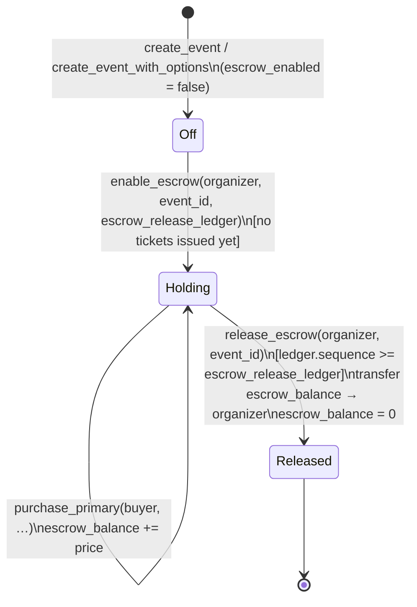

# Architecture

## Source layout

The contract entry points and shared authorization/status guards live in
`contracts/ticketing/src/lib.rs`. `types.rs` owns contract data types and the
packed ticket lifecycle encoding; `error.rs` owns the error enum. Both modules
are private, with their public types re-exported from the crate root, so Rust
consumers continue to import `stellar_tickets_ticketing::{Ticket, Event, Error}`.
Moving ticket encoding into `types.rs` preserves the public ABI and storage
format; the isolated move produces byte-identical WASM.

Organizer-authorized operations use `require_organizer` after requiring the
caller's signature. Operations that reject both used and revoked tickets use
`require_not_terminal`; check-in additionally rejects resale listings. Plain
revocation and seat reassignment retain their existing ability to act on used
tickets, so they only reject revoked tickets.

## Storage layout

The `ticketing` contract uses instance storage and persistent storage entries.
The complete reference — every `DataKey` variant, its value type, storage kind,
and when its TTL is extended — lives in [`STORAGE_LAYOUT.md`](STORAGE_LAYOUT.md).
That page is kept in lockstep with `lib.rs`; this section summarises the
rationale only.

- **Instance storage**: `Admin`, `PaymentToken`, `TokenDecimals`, `NextTicketId`, `MinPurchaseSpacing`, `PendingPaymentToken`, `Paused` — set at `initialize` and read on nearly every call.
- **Persistent storage, keyed by `Event(u64)`**: one entry per event, holding the organizer address and resale policy. The issuance counter is kept separately in `TicketsIssued(u64)`, so minting does not rewrite the full event record.
- **Persistent storage, keyed by `OrganizerEvents(Address)`**: one count per organizer, incremented when an event is created.
- **Persistent storage, keyed by `Ticket(u64)`**: one entry per ticket, holding owner, tier, seat, status, and pricing.
- **Persistent storage, keyed by `GiftClaim(u64)`**: one entry per active gift claim, holding the secret hash and expiry.
- **Persistent storage, keyed by `LastPurchaseLedger(Address)`**: one entry per buyer, tracking the ledger sequence of their last primary purchase for the purchase throttle.
- **Persistent storage, keyed by the owner index** (`OwnerBalance`, `OwnerTicketCount`, `OwnerTicketAt`, `TicketOwnerPos`): a swap-remove index backing SEP-50 `balance` and `tickets_of` (issue #111). The naming convention for index keys is documented in [`STORAGE_LAYOUT.md`](STORAGE_LAYOUT.md#index-naming-convention-issue-52).

### Storage diagram

```text
Instance storage (contract-wide, extended on every call)
├── Admin                          → Address
├── PaymentToken                   → Address
├── TokenDecimals                  → u32
├── NextTicketId                   → u64 (monotonic)
├── MinPurchaseSpacing             → u32 (0 = disabled)
└── PendingPaymentToken            → Option<PendingPaymentToken>

Persistent storage (per-entry TTL, extended on write)
├── Event(u64)                     → Event
│   ├── organizer: Address
│   ├── name: String
│   ├── category: String
│   ├── max_resale_multiplier_bps: u32
│   ├── min_resale_multiplier_bps: Option<u32>
│   ├── max_transfers_per_ticket: Option<u32>
│   ├── royalty_bps: u32
│   ├── tickets_issued: u64 (mirrored from TicketsIssued)
│   ├── starts_at: u64
│   ├── transfer_freeze_seconds: u64
│   ├── resale_cutoff_seconds: u64
│   ├── escrow_enabled: bool
│   ├── escrow_release_ledger: u32
│   ├── escrow_balance: i128
│   ├── payment_token: Option<Address>
│   └── transferable: bool (false = soulbound)
│
├── TicketsIssued(u64)             → u64 (per-event counter, separate to avoid Event rewrite)
├── OrganizerEvents(Address)       → u32
├── OrganizerEventAt(Address, u32) → u64 (paginated organizer event list)
├── Ticket(u64)                    → Ticket
│   ├── event_id: u64
│   ├── owner: Address
│   ├── tier: String
│   ├── seat: String
│   ├── status: TicketStatus (Valid | Used | Revoked | Resale)
│   ├── original_price: i128
│   ├── resale_price: i128
│   └── transfers: u32
├── GiftClaim(u64)                 → GiftClaim
│   ├── from: Address
│   ├── secret_hash: BytesN<32>
│   └── expires_at: u64
├── LastPurchaseLedger(Address)    → u32 (for purchase throttle)
├── TicketMetadataUri(u64)         → String (optional, set at issuance)
└── OwnerBalance(Address)          → u64 (tickets held, backs SEP-50 `balance`)
```

### Why persistent storage for events and tickets

Instance storage is cheap to read but expires with the contract instance's own TTL and isn't a good fit for data that individual ticket owners depend on staying alive independently of contract upgrades. Persistent storage entries are extended on every ticket write (`extend_ttl` in `save_ticket`) so an active ticket never lapses. Event records are extended when they are created; the full policy, the archival behavior, and the off-chain keepalive job that covers the rest are in [`STORAGE_TTL.md`](STORAGE_TTL.md).

### Counter placement and mint benchmark

`NextTicketId` remains in instance storage because it is one contract-wide hot counter. Moving it to persistent storage would add a hot persistent entry without removing the read and write required for allocation. The per-event `TicketsIssued` counter is persistent because it is event-scoped.

The budget regression test `issue_ticket_stays_under_cost_thresholds` measures the post-migration mint path. Comparing `env.cost_estimate().budget()` before and after the migration demonstrates the saving from removing the full `Event` write and keeps a ceiling against future regressions.

---

## Roles and authorization model

Every state-changing function calls `require_auth()` on the account that must have approved the action, **before** any storage read or business-rule check (see issue #206).

| Role | Entry points | Scope |
|------|--------------|-------|
| **Contract admin** (set at `initialize`) | `set_purchase_throttle`, `propose_payment_token`, `apply_payment_token` | Platform-level config only; **no per-ticket authority** |
| **Event organizer** (per `Event.organizer`) | `create_event*`, `issue_ticket`, `enable_escrow`, `set_event_payment_token`, `check_in*`, `revoke_ticket*`, `set_seat`, `revoke_batch` | Full control over **their own events only** |
| **Ticket owner** (per `Ticket.owner`) | `transfer_ticket`, `transfer_batch`, `create_gift_claim`, `list_for_resale`, `cancel_resale` | Only while ticket is `Valid` or `Resale` |
| **Buyer** (any address) | `purchase_primary`, `buy_resale`, `claim_gift` | Pays and receives ownership atomically |
| **Anyone** (read-only) | `get_event`, `get_ticket`, `verify_tickets`, `is_ticket_valid`, `is_valid`, `event_payment_token`, `token_decimals`, `get_organizer_events` | No auth required |

### Authorization ordering (critical)

```text
Entry point
    │
    ▼
require_auth(caller) ◀── FIRST: no state read, no business logic
    │
    ▼
Storage reads / business validation
    │
    ▼
State writes
    │
    ▼
External calls (token.transfer)
```

This ordering ensures an unauthenticated caller learns nothing about contract state (existence of ticket/event, ownership, status) from the error they receive.

---

## Key flows

### 1. Event creation

```text
Organizer
    │
    ▼
create_event / create_event_with_options
    │  ├─ require_auth(organizer)
    │  ├─ validate royalty_bps ≤ 10_000
    │  ├─ validate starts_at > now
    │  ├─ EventAlreadyExists check
    │  ├─ write Event(u64)
    │  ├─ write TicketsIssued(u64) = 0
    │  ├─ increment OrganizerEvents(organizer)
    │  └─ extend TTL on both keys
    ▼
Event created (persistent)
```

### 2. Primary purchase (on-chain)

```text
Buyer
    │
    ▼
purchase_primary
    │  ├─ require_auth(buyer)
    │  ├─ enforce_purchase_throttle(buyer)
    │  ├─ load Event
    │  ├─ token.transfer(buyer → organizer OR contract if escrow)
    │  ├─ mint Ticket (status=Valid, original_price=price)
    │  ├─ increment TicketsIssued
    │  ├─ record LastPurchaseLedger(buyer)
    │  └─ extend TTL on ticket
    ▼
Ticket minted + funds transferred (atomic)
```

### 3. Resale listing

```text
Ticket owner
    │
    ▼
list_for_resale
    │  ├─ require_auth(owner)
    │  ├─ validate price > 0
    │  ├─ validate ticket owned by caller, status ∈ {Valid, Resale}
    │  ├─ validate resale not closed (timestamp < starts_at - cutoff)
    │  ├─ cap = original_price * max_resale_multiplier_bps / 10_000
    │  ├─ floor = original_price * min_resale_multiplier_bps / 10_000 (if set)
    │  ├─ validate price ≤ cap (and ≥ floor if set)
    │  ├─ ticket.status = Resale, ticket.resale_price = price
    │  ├─ delete any GiftClaim
    │  └─ extend TTL
    ▼
Ticket listed for resale
```

### 4. Resale purchase

```text
Buyer
    │
    ▼
buy_resale
    │  ├─ require_auth(buyer)
    │  ├─ validate ticket.status == Resale
    │  ├─ validate resale not closed
    │  ├─ validate transfer allowed (max_transfers_per_ticket)
    │  ├─ royalty = resale_price * royalty_bps / 10_000
    │  ├─ seller_amount = resale_price - royalty
    │  ├─ token.transfer(buyer → organizer, royalty)     (if royalty > 0)
    │  ├─ token.transfer(buyer → seller, seller_amount) (if seller_amount > 0)
    │  ├─ ticket.owner = buyer
    │  ├─ ticket.transfers += 1
    │  ├─ ticket.status = Valid, ticket.resale_price = 0
    │  ├─ delete any GiftClaim
    │  └─ extend TTL
    ▼
Ownership transferred + royalty split (atomic)
```

### 5. Direct transfer (gift)

```text
Current owner
    │
    ▼
transfer_ticket
    │  ├─ require_auth(from)
    │  ├─ validate ticket owned by caller, status ∈ {Valid, Resale}
    │  ├─ validate transfer not frozen (timestamp < starts_at - freeze)
    │  ├─ validate transfer allowed (max_transfers_per_ticket)
    │  ├─ ticket.owner = to
    │  ├─ ticket.transfers += 1
    │  ├─ ticket.status = Valid, ticket.resale_price = 0
    │  ├─ delete any GiftClaim
    │  └─ extend TTL
    ▼
Ownership transferred (no payment)
```

### 6. Gift claim

```text
Owner (off-chain)          Recipient
    │                          │
    ├─ create_gift_claim       │
    │  ├─ require_auth(owner)  │
    │  ├─ store GiftClaim(secret_hash, expires_at)
    │  └─ ticket.status stays same
    │                          │
    │        secret (preimage) │
    │  ◀────────────────────── │
    │                          │
    │                    claim_gift
    │                          ├─ require_auth(recipient)
    │                          ├─ validate expires_at > now
    │                          ├─ validate sha256(secret) == secret_hash
    │                          ├─ validate ticket still owned by claim.from
    │                          ├─ validate transfer allowed
    │                          ├─ ticket.owner = recipient
    │                          ├─ ticket.transfers += 1
    │                          ├─ delete GiftClaim
    │                          └─ extend TTL
    │                          ▼
    │                    Ownership transferred
    │
    ▼
```

### 7. Check-in (gate entry)

```text
Organizer (or gate device)
    │
    ▼
check_in / check_in_batch
    │  ├─ require_auth(organizer)
    │  ├─ validate ticket belongs to this event
    │  ├─ validate ticket.status ∈ {Valid, Resale}
    │  ├─ ticket.status = Used
    │  ├─ delete any GiftClaim
    │  ├─ extend TTL
    │  └─ emit TicketCheckedIn
    ▼
Ticket marked Used (terminal)
```

### 8. Revocation

```text
Organizer
    │
    ▼
revoke_ticket / revoke_with_refund / revoke_batch
    │  ├─ require_auth(organizer)
    │  ├─ validate ticket belongs to this event
    │  ├─ validate ticket.status != Used
    │  ├─ if refund && original_price > 0:
    │  │     token.transfer(organizer → ticket.owner, original_price)
    │  ├─ ticket.status = Revoked (terminal)
    │  ├─ delete any GiftClaim
    │  └─ extend TTL
    ▼
Ticket revoked (permanently unusable)
```

---

## Invariants

### Storage invariants

| Invariant | Where enforced |
|-----------|----------------|
| `Event(u64)` exists ⇔ `TicketsIssued(u64)` exists | `create_event*`, never deleted |
| `Ticket(u64).event_id` references an existing `Event` | `mint` only called after `Event` exists |
| `Ticket.owner` is always the current holder | All transfers update atomically |
| `Ticket.status` ∈ {Valid, Used, Revoked, Resale} | Enum, all transitions explicit |
| `Ticket.resale_price > 0` ⇔ `Ticket.status == Resale` | `list_for_resale`, `cancel_resale`, `buy_resale`, `transfer_ticket`, `create_gift_claim` |
| `GiftClaim(u64)` exists ⇒ `Ticket(u64).owner == GiftClaim.from` | `create_gift_claim` checks ownership; deleted on any transfer/check-in/revoke |
| `OrganizerEvents(organizer)` ≥ actual events | Only incremented, never decremented |
| `NextTicketId` strictly increasing | Only set to `ticket_id + 1` in `mint` |

### Economic invariants

| Invariant | Where enforced |
|-----------|----------------|
| `resale_price ≤ cap = original_price * max_resale_multiplier_bps / 10_000` | `list_for_resale` |
| `resale_price ≥ floor = original_price * min_resale_multiplier_bps / 10_000` (if floor set) | `list_for_resale` |
| `royalty = resale_price * royalty_bps / 10_000` (truncating) | `buy_resale` |
| `seller_amount = resale_price - royalty` (remainder) | `buy_resale` |
| `royalty + seller_amount == resale_price` (no value lost) | By construction |
| Escrow balance only decreases in `release_escrow` | `purchase_primary` increases, `release_escrow` decreases to 0 |
| Escrow release only after `escrow_release_ledger` reached | `release_escrow` |
| Per-event payment token locked after first ticket issued | `set_event_payment_token` checks `tickets_issued == 0` |

### Temporal invariants

| Invariant | Where enforced |
|-----------|----------------|
| Transfers frozen when `now ≥ starts_at - transfer_freeze_seconds` | `transfer_frozen` check in `transfer_ticket`, `transfer_batch`, `claim_gift` |
| Resale closed when `now ≥ starts_at - resale_cutoff_seconds` | `resale_closed` check in `list_for_resale`, `buy_resale` |
| Event must start in future at creation | `create_event*` validates `starts_at > now` |
| Gift claim expires at `expires_at` | `claim_gift` validates `now < expires_at` |

### Authorization invariants

| Invariant | Where enforced |
|-----------|----------------|
| Only `Event.organizer` can call organizer-restricted functions | `require_auth` + `event.organizer == caller` check |
| Only `Ticket.owner` can call owner-restricted functions | `require_auth` + `ticket.owner == caller` check |
| Admin has no ticket/event authority | No admin checks in ticket/event entry points |
| `require_auth` called before any storage read | Code review (see issue #206) |

---

## Payment settlement

All monetary transfers go through a single SEP-41 `payment_token` configured at `initialize`. `purchase_primary` and `buy_resale` are the only functions that move funds; both do so atomically with the ownership change in the same transaction.

### Escrow lifecycle

When an organizer opts an event into escrow mode, primary sale proceeds are held by the contract rather than paid out immediately. The escrow has three states:

- **Off** — default; primary sale proceeds go directly to the organizer.
- **Holding** — `enable_escrow` has been called (before any tickets are sold) and `escrow_release_ledger` is set; every `purchase_primary` call transfers funds to the contract and increments `escrow_balance`.
- **Released** — `release_escrow` has been called after the ledger sequence reached `escrow_release_ledger`; the full `escrow_balance` is transferred to the organizer and the balance is zeroed.



**Constraints:**
- `enable_escrow` is rejected if any ticket has already been sold (`tickets_issued > 0`) — it would otherwise retroactively change the payment terms for completed purchases.
- `release_escrow` is rejected before `escrow_release_ledger` is reached (`EventNotEnded` error).
- `release_escrow` is rejected on events where escrow was never enabled (`EscrowNotEnabled` error).
- The `escrow_balance` on the `Event` record is the single source of truth; it is incremented by every `purchase_primary` and zeroed by `release_escrow`.

### Payment token resolution (issue #235)

```text
event.payment_token (Some) ──▶ per-event token
                │
                ▼ (None)
contract-wide PaymentToken ──▶ global token
```

Per-event token can only be set while `tickets_issued == 0` to keep existing sales denominated in the token they were paid in.

---

## Cap and royalty formulas

See [`CAP_ROYALTY_ROUNDING.md`](CAP_ROYALTY_ROUNDING.md) for detailed formulas with rounding examples.

---

## Related documentation

- [`THREAT_MODEL.md`](THREAT_MODEL.md) — assets, trust boundaries, residual risks
- [`STORAGE_TTL.md`](STORAGE_TTL.md) — storage lifetime policy
- [`CAP_ROYALTY_ROUNDING.md`](CAP_ROYALTY_ROUNDING.md) — rounding behavior
- [`ERRORS.md`](ERRORS.md) — full error table
- [`EVENTS.md`](EVENTS.md) — on-chain events
- [`INTEGRATION.md`](INTEGRATION.md) — backend integration guide